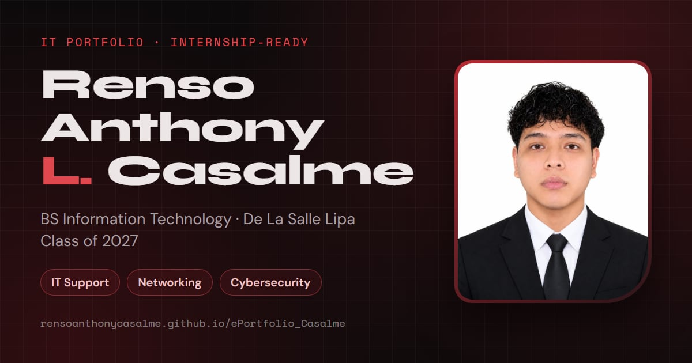

# Renso Anthony L. Casalme · IT Portfolio

**Live:** https://rensoanthonycasalme.github.io/ePortfolio_Casalme/



Personal portfolio of a BS Information Technology student at De La Salle Lipa (Class of 2027), focused on IT support, networking and cybersecurity, and looking for an internship.

## What's on the site

- **Evidence scan:** skills shown as `nmap` output; every "open" skill links to the certificate that backs it, instead of self-rated percentages.
- **Networking Lab:** a Break/Fix lab (find the misconfiguration that stops a ping: gateway, mask, route, ACL, DNS) and a Subnet Lab (IPv4 calculator that shows the binary AND, with a quiz).
- **Terminal:** press <kbd>`</kbd> or the `>_` button. Try `help`, `traceroute renso`, `ping`, `curl -I`, `dig github.com`, `audit`.
- **Role lens:** `?role=helpdesk`, `?role=noc` or `?role=soc` highlights what matters for that kind of internship.
- **Security self-check:** footer button; real checks of this page (HTTPS, HSTS, CSP, third-party requests, cookies…) run in your browser.
- **Recruiter CTF:** 3 flags are hidden on the site. The footer explains the rules.
- Red and black theme (light variant available), print-ready one-page résumé, honest motion controls (respects "reduce motion").

## Tech

[Astro 7](https://astro.build) static site · GSAP 3 (bundled, no CDN) · self-hosted fonts (Fontsource) and Font Awesome 6 · no cookies, no trackers, no third-party requests · Content-Security-Policy with hashed scripts · deployed to GitHub Pages with GitHub Actions.

## Editing the content

Almost everything you'd want to change lives in **`src/data/portfolio.json`**. Slots that are empty render nothing on the site, so fill them only with real information:

| Key | What to put there |
| --- | --- |
| `resume.pdf` | e.g. `"resume/Casalme_Renso_Resume.pdf"` after adding the file to `public/resume/`. The button then downloads it instead of printing the built-in résumé. |
| `ojt` | Required OJT `hours`, internship `window`, `setup` (onsite/hybrid/remote), `commute` area, `moa` (endorsement needed?). |
| `certs[].verifyUrl` | Credly / NetAcad verification links; adds a "Verify credential" button. |
| `now` | `updated` date (YYYY-MM-DD), current `focus`, `next` milestone, dated `entries`. Shows as now.log and turns "stale" after 45 days. |
| `labs` | Your own lab write-ups (see the comment in `src/scripts/site.js`, Feature 47). Can be linked from `skills[].evidence` with `{ "lab": "<id>" }`. |
| `tools`, `learningNext` | Lists of tools you have really used and what you are learning next. |
| `roles[].weekOne`, `roles[].toLearn` | One honest line each per role for the role lens. |
| `netlab.hint`, `netlab.explore` | Your own troubleshooting method, and your real Packet Tracer build (outputs, addressing table, .pkt file). |
| `ipcalc` | `repo` and `code` of a Python subnet calculator **you** wrote. |
| `about.story` | A short story, in your words, about why IT. |

Section text and layout live in `src/components/*.astro`; styles in `src/styles/`; behaviour in `src/scripts/`.

## Running it locally (Windows)

Node.js is installed portably at `D:\tools\node` (no admin rights needed). In Git Bash:

```bash
export PATH="/d/tools/node:$PATH"
npm install          # first time only
npm run dev          # live preview at http://localhost:4321/ePortfolio_Casalme/
npm run build        # production build into dist/
npm run preview      # serve the production build (CSP is only active here, not in dev)
```

## Deploying

Every push to `main` builds and deploys automatically (`.github/workflows/deploy.yml`).
One-time setup on GitHub: **Settings → Pages → Build and deployment → Source: GitHub Actions**.

## Project structure

```
src/
  pages/index.astro        the page: composes the sections, prepares images, JSON-LD
  pages/404.astro          "Destination host unreachable"
  layouts/Base.astro       <head>, fonts, icons, link-preview tags, stylesheets
  components/              one file per section (Hero, Skills, Lab, Trainings, Terminal…)
  data/portfolio.json      all the content
  scripts/                 site.js · labs/ · terminal.js · ctf.js · audit.js · motion.js
  styles/                  01-tokens … 07-terminal (imported in order)
  assets/img/              photo and certificates (optimized to WebP at build time)
public/                    robots.txt, sitemap.xml, og.jpg, icons
```
